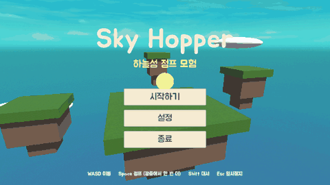

# MyFirst3DGame — Sky Hopper (가제)

구름 위 **하늘섬**을 **더블점프와 대시**로 건너며 코인을 모으고 최단 기록에 도전하는 로우폴리 3D 플랫포머입니다.
자세한 기획은 [GAME_DESIGN.md](GAME_DESIGN.md)를 참고하세요.

▶ **브라우저에서 바로 플레이: https://sky-hopper-eight.vercel.app**



## 개발 환경
- Unity **6.6 (6000.6.6f1)**, URP
- 새 Input System
- 목표 플랫폼: Windows (exe), WebGL

## 프로젝트 열기
1. 이 저장소에는 그림·소리 같은 큰 파일이 **Git LFS**로 들어 있습니다. 먼저 [Git LFS](https://git-lfs.com)를 설치하세요.
2. 저장소를 내려받습니다.
   ```
   git clone https://github.com/dyj02056/MyFirst3DGame.git
   ```
3. Unity Hub → **프로젝트 → 추가 → 디스크에서 프로젝트 추가** → 내려받은 폴더를 선택합니다.

## 씬 만들기
씬은 에디터 메뉴로 자동 생성됩니다. 상단 메뉴 **Sky Hopper**에서 고르세요.

| 메뉴 | 만들어지는 씬 |
|---|---|
| 스테이지 1 만들기 | `Assets/_SkyHopper/Scenes/Stage1.unity` |
| 1주차 테스트 맵 만들기 | 조작감 테스트용 `TestMovement.unity` |
| 3주차 장치 테스트 맵 만들기 | 장치 프리팹 5종 + `GimmickTest.unity` |

## 빌드
상단 메뉴 **Sky Hopper → 빌드**에서 고르세요. 결과물은 `Builds/` 폴더에 생기며 git에는 올라가지 않습니다.

| 메뉴 | 결과 |
|---|---|
| Windows 빌드 (exe) | `Builds/Windows/SkyHopper.exe` — 폴더째 압축해서 공유 |
| 웹 빌드 (WebGL) | `Builds/WebGL` — 웹 서버나 itch.io에 업로드 |
| 웹 빌드 후 브라우저에서 실행 | 빌드 후 내 컴퓨터에서 바로 브라우저로 열어 봄 |

- 이미 만든 웹 빌드를 다시 열 때: `웹게임_실행.bat` 더블클릭 (Python 필요)
- 웹 빌드를 Vercel에 다시 배포할 때 (`Builds/WebGL` 폴더에서):
  ```
  npx vercel deploy --prod --yes
  ```

## 플레이 GIF 다시 만들기
위 GIF는 게임이 스스로 플레이하는 자동 시연을 녹화해서 만들었습니다 (`Assets/_SkyHopper/Scripts/Core/DemoRecorder.cs`).
1. Windows 빌드를 만든 뒤, 녹화 옵션을 붙여 실행합니다 (소리는 꺼지고, 끝나면 저절로 닫힘).
   ```
   Builds\Windows\SkyHopper.exe -screen-fullscreen 0 -screen-width 640 -screen-height 360 -sh-demo C:\frames
   ```
2. 녹화된 프레임을 GIF로 합칩니다 (Python + Pillow 필요).
   ```
   python Tools/make_gif.py C:\frames Docs/gameplay.gif --step 2 --width 480 --colors 128
   ```

## 조작
| 키 | 동작 |
|---|---|
| W A S D | 이동 |
| 마우스 | 카메라 회전 |
| Space | 점프 (공중에서 한 번 더 = 더블점프) |
| 왼쪽 Shift | 대시 |
| R | 다시 시작 |
| Esc | 마우스 커서 보이기 |

## 폴더 구조
```
Assets/_SkyHopper/
├─ Scripts/
│  ├─ Player/     플레이어 입력·이동
│  ├─ Camera/     3인칭 카메라
│  ├─ Stage/      코인, 체크포인트, 골, 스테이지 관리
│  ├─ Gimmicks/   움직이는 발판, 떨어지는 발판, 가시, 회전 막대, 점프대
│  ├─ UI/         화면 표시 (HUD)
│  └─ Editor/     씬 자동 생성 메뉴
├─ Prefabs/Gimmicks/
├─ Materials/
└─ Scenes/
```
그 밖의 `Assets` 폴더 내용은 Unity "Get Started" 템플릿에 들어 있던 자료입니다.
